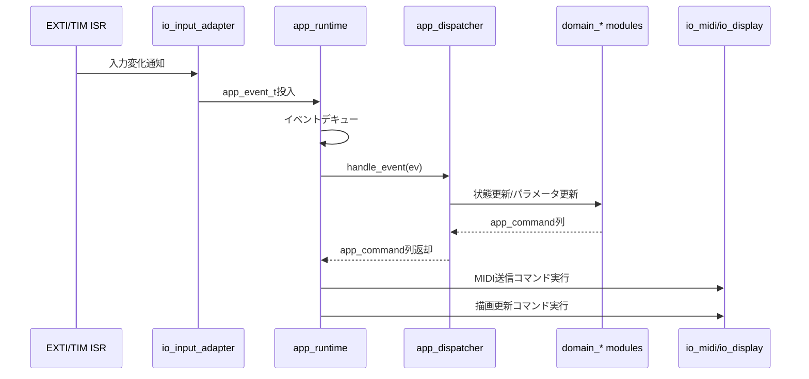
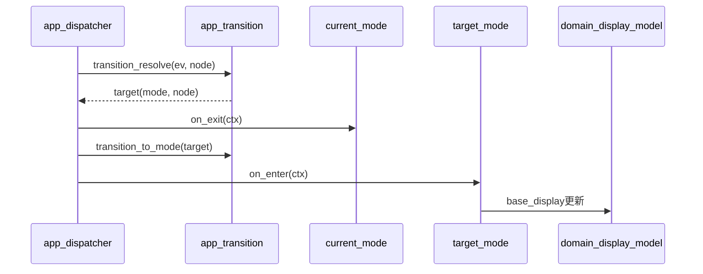
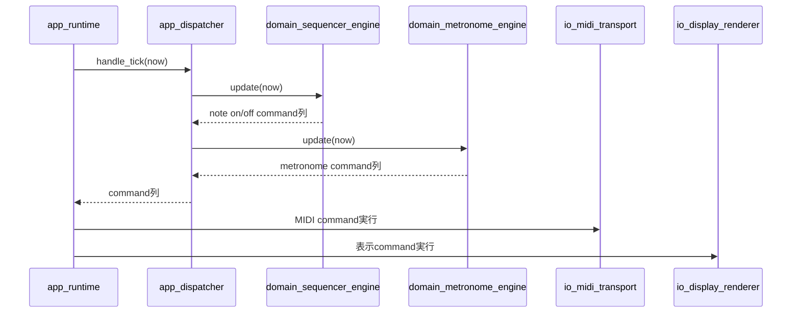

# MIDI Synth Controller Core 再構築 実装設計書

## 1. 文書目的
本書は、現行の機能仕様を維持したまま Core 配下ソースコードを再構築するための実装設計を定義する。

## 2. スコープ

### 2.1 対象
- Core内部の構造再編
- モード制御、入力処理、表示処理、MIDI処理の責務分離
- 追加モード容易化と遷移階層可変化の設計

### 2.2 非対象
- USB_HOST ライブラリ内部改修
- HAL/CubeMX生成方針の変更
- 実行速度最適化を主目的とする改修

## 3. 設計方針
- 現行動作互換を最優先とする
- 入力、モード遷移、モード動作、表示を疎結合化する
- モード追加はテーブル定義中心で完結させる
- 遷移階層の深さ変更をデータ定義で対応可能にする
- 可読性、保守性、拡張性を実行速度より優先する

## 4. 互換要件
- 互換要件の正本は `docs/core_function_spec.md` とする
- 互換対象は以下とする
	- モード一覧と遷移挙動
	- パラメータ範囲、ステップ、適用タイミング
	- LED表示の状態遷移と一時表示復帰挙動
	- MIDI出力内容と出力タイミング
	- シーケンサ記録/再生/ミュート/編集挙動

## 5. 全体アーキテクチャ

### 5.1 レイヤ構成
- I/O層
	- Input Adapter(encoder/button)
	- MIDI Transport(SPI RX/TX)
	- Display Driver(Neopixel送信)
- アプリケーション層
	- Event Queue
	- Event Dispatcher
	- Mode Runtime
	- Transition Engine
- ドメイン層
	- Parameter Registry
	- Sequencer Engine
	- Metronome Engine
	- Display Model

### 5.2 依存方向
- I/O -> App -> Domain
- Domain は HAL に依存しない
- 描画とMIDI送信は Command 化して App から I/O に渡す

### 5.3 処理モデル
- 割り込みはイベント生成のみを行う
- メインループでイベントを消費し、状態遷移とコマンド生成を行う
- 描画更新とMIDI送信はキュー経由で非同期実行する

## 6. 新規ファイル構成案
```
Core/
	Inc/
		app_runtime.h
		app_event.h
		app_dispatcher.h
		app_transition.h
		domain_mode_def.h
		domain_parameter_registry.h
		domain_sequencer_engine.h
		domain_metronome_engine.h
		domain_display_model.h
		io_input_adapter.h
		io_midi_transport.h
		io_display_renderer.h
	Src/
		app_runtime.c
		app_dispatcher.c
		app_transition.c
		domain_mode_def.c
		domain_parameter_registry.c
		domain_sequencer_engine.c
		domain_metronome_engine.c
		domain_display_model.c
		io_input_adapter.c
		io_midi_transport.c
		io_display_renderer.c
```

## 7. コンポーネント設計

### 7.1 Input Adapter
- 責務
	- EXTI/TIM起点の入力情報を `InputEvent` に変換
	- チャタリングや回転判定をここで完結
	- 長押しイベントの判定を実施
- 出力
	- `EV_ROTATE`, `EV_BUTTON_DOWN`, `EV_BUTTON_UP`, `EV_LONG_PRESS`
- 長押し判定仕様
	- 長押し閾値: 600ms(既定値)
	- 発火条件: `EV_BUTTON_DOWN` から連続押下状態が閾値を超過
	- 再発火: 同一押下中は再発火しない(1回のみ)

### 7.2 Event Dispatcher
- 責務
	- `InputEvent` を現在のモード・遷移ノードに応じて解釈
	- ドメイン更新と `OutputCommand` 生成

### 7.3 Mode Runtime
- 責務
	- 現在モード、現在遷移ノード、overlay表示状態を保持
	- `on_enter/on_event/on_tick/on_exit` 呼び出し順制御

### 7.4 Transition Engine
- 責務
	- 木構造ノードを用いた遷移制御
	- 階層深さをデータ定義のみで変更可能にする

### 7.5 domain_parameter_registry
- 責務
	- パラメータ値、範囲、ステップ、表示形式、適用アクション定義
	- 現行 `switch` 集約ロジックをテーブル化して置換

### 7.6 domain_sequencer_engine
- 責務
	- bar/beat進行、layer管理、note記録/再生/mute
	- 既存タイミングと状態更新順序を維持

### 7.7 io_display_renderer
- 責務
	- 表示モデルからフレーム生成
	- ハード依存送信のみ担当

### 7.8 io_midi_transport
- 責務
	- 4byte MIDIパケットの入出力
	- RX/TXバッファ管理

## 8. データモデル

### 8.1 Event
```
typedef enum {
	EV_NONE,
	EV_ROTATE,
	EV_BUTTON_DOWN,
	EV_BUTTON_UP,
	EV_LONG_PRESS,
	EV_TICK
} app_event_type_t;
```

### 8.2 Output Command
```
typedef enum {
	CMD_NONE,
	CMD_MIDI_SEND,
	CMD_DISPLAY_UPDATE,
	CMD_MODE_CHANGE
} app_command_type_t;
```

- `CMD_DISPLAY_UPDATE` の payload は「画面ID」ではなく「描画要求」を表す。
- 描画要求の粒度は `domain_display_model` 単位(全面再描画/差分更新の別は renderer 側で吸収)とする。

### 8.3 表示状態定義
```
typedef enum {
	DOMAIN_DISPLAY_NOTE,
	DOMAIN_DISPLAY_METRONOME,
	DOMAIN_DISPLAY_SEQUENCER_PARA,
	DOMAIN_DISPLAY_SEQUENCER_PROGRAM,
	DOMAIN_DISPLAY_SEQUENCER_REC,
	DOMAIN_DISPLAY_SEQUENCER_PLAY,
	DOMAIN_DISPLAY_SETTING,
	DOMAIN_DISPLAY_OVERLAY
} domain_display_state_t;
```

- 既存 `display_state_t` は互換レイヤで `domain_display_state_t` へ変換する。
- App/Domain境界では `domain_display_state_t` を正本とする。

### 8.4 Mode定義
```
typedef struct {
	mode_state_t mode_id;
	domain_display_state_t base_display;
	const input_map_t *input_map;
	const param_set_t *param_set;
	handler_t on_enter;
	handler_t on_event;
	handler_t on_tick;
	handler_t on_exit;
} domain_mode_def_t;
```

### 8.5 主要補助型
```
typedef enum {
	NODE_MENU,
	NODE_ACTION,
	NODE_MODE
} node_type_t;

typedef struct {
	uint8_t source;
	app_event_type_t event_type;
	uint16_t target_id;
} input_map_t;

typedef struct {
	uint16_t param_id;
	int32_t min;
	int32_t max;
	int32_t step;
} param_set_t;

typedef void (*handler_t)(void *ctx, const app_event_t *ev, app_command_t *out_cmds, uint8_t *out_count);
```

### 8.6 遷移ノード
```
typedef struct {
	uint16_t node_id;
	uint16_t parent_id;
	const uint16_t *children;
	uint8_t child_count;
	node_type_t type;
	mode_state_t mode_target;
} transition_node_t;
```

## 9. 追加モード容易化設計
- 新規モード追加手順
	- `mode_state_t` にID追加
	- `domain_mode_def_table[]` に定義追加
	- 必要パラメータを `domain_parameter_registry` に追加
	- 表示定義を `domain_display_model` に追加
- 既存モードへの影響を局所化する
	- 既存 `domain_mode_def` を編集せず、新規行追加で完結

## 10. 遷移階層可変設計
- 遷移木の深さを固定コードで持たない
- ノード定義配列の変更のみで階層増減可能
- ルート、兄弟移動、親復帰の操作規約を統一する

## 11. 処理シーケンス

### 11.1 起動
1. HAL初期化
2. I/O層初期化
3. App Runtime初期化
4. 初期モード `on_enter` 実行

### 11.2 メインループ
1. `InputEvent` をキューから取得
2. `EventDispatcher` がモードハンドラへ配送
3. `domain_parameter_registry/domain_sequencer_engine/domain_metronome_engine` 更新
4. `OutputCommand` を実行

### 11.3 割り込み
- 割り込みハンドラはイベント投入のみ実施
- 状態遷移・描画・MIDI処理は割り込み外で実行

## 12. 現行責務の移管
| 現行責務 | 主な現行位置 | 新責務先 |
|---|---|---|
| エンコーダ入力解釈 | `Core/Src/mode.c` | `io_input_adapter` |
| モード別入力分岐 | `Core/Src/mode.c` | `app_dispatcher` + `domain_mode_def` |
| パラメータ範囲制御 | `Core/Src/mode.c` | `domain_parameter_registry` |
| 描画分岐 | `Core/Src/stm32_synth_midi.c` | `domain_display_model` + `io_display_renderer` |
| MIDI送信API呼び出し | `Core/Src/mode.c`, `Core/Src/stm32_synth_midi.c` | `io_midi_transport` |
| シーケンサ進行 | `Core/Src/stm32_synth_midi.c` | `domain_sequencer_engine` |

## 13. 段階移行計画

### Phase 1: 互換要件固定
- チェックリスト作成
- 既存仕様をテスト観点へ展開

### Phase 2: 低リスク分離
- domain_parameter_registry導入
- Event Queue/Dispatcher導入

### Phase 3: 遷移と表示分離
- Transition Engine導入
- domain_display_model/io_display_renderer分離

### Phase 4: シーケンサ分離
- domain_sequencer_engine独立
- 既存挙動との差分検証

### Phase 5: 切替と整理
- 旧経路削除
- 残存依存の整理

## 14. 検証設計

### 14.1 互換シナリオ
- 全モード遷移の一致
- ノブ回転/ボタン押下に対する出力一致
- タップテンポ一致
- 録音/再生/ミュート/UNDO/CH CLEAR一致

### 14.2 境界試験
- BPM最小/最大
- bar最小/最大
- channel 0-16
- metronome on/off

### 14.3 回帰試験
- HELLO表示復帰
- BLE表示
- DFU遷移
- SPI5 RX -> SPI3 TX 経路

### 14.4 判定基準
- MIDI出力列が一致すること
- 表示状態列が一致すること
- 表示更新タイミング差は1フレーム以内を許容

## 15. リスクと対策
- リスク: モード遷移差分
	- 対策: 遷移ログ比較を自動化
- リスク: パラメータ境界差分
	- 対策: Registry単体試験で上下限を網羅
- リスク: シーケンサon/offタイミング差分
	- 対策: 時系列イベント再生試験を実施
- リスク: 割り込み由来イベント取りこぼし
	- 対策: キュー使用率監視と飽和時ログ出力

## 16. 完了条件
- `docs/core_function_spec.md` に対し互換要件を満たす
- 主要機能の回帰テストが全て合格する
- 新規モードを既存モード改変なしで1件追加できることを実証する
- 遷移階層深さ変更をノード定義変更のみで実証する

## 17. 公開インタフェース設計

### 17.1 app_runtime
| 関数名 | 役割 | 呼び出し元 | 備考 |
|---|---|---|---|
| app_runtime_init | 実行時コンテキスト初期化 | main初期化シーケンス | 初期モード、初期ノードを設定 |
| app_runtime_start | 初期モード on_enter 実行 | main初期化シーケンス | 初期表示/初期MIDIコマンド発行 |
| app_runtime_step | 1サイクル処理 | mainループ | イベント消費、tick処理、コマンド実行 |
| app_runtime_post_event | イベント投入 | 割り込み層、USB受信層 | lock-freeまたは短区間クリティカルセクション |

### 17.2 app_dispatcher
| 関数名 | 役割 | 入力 | 出力 |
|---|---|---|---|
| app_dispatcher_handle_event | 現在モードへイベント配送 | app_event_t | app_command_t列 |
| app_dispatcher_handle_tick | 周期処理配送 | 現在時刻tick | app_command_t列 |

### 17.3 app_transition
| 関数名 | 役割 | 備考 |
|---|---|---|
| app_transition_to_mode | モード遷移実行 | on_exit -> on_enter を保証 |
| app_transition_to_node | ノード遷移実行 | 階層深さ非依存 |
| app_transition_resolve | 入力に対する遷移先解決 | transition_node_t と input_map_t を参照 |

### 17.4 domain_mode_def
| 関数名 | 役割 | 備考 |
|---|---|---|
| domain_mode_def_get | mode_id から mode定義を取得 | `domain_mode_def_table[]` を参照 |
| domain_mode_def_get_default | 初期 mode定義を取得 | 起動時に使用 |

### 17.5 domain_parameter_registry
| 関数名 | 役割 | 備考 |
|---|---|---|
| domain_parameter_registry_init | パラメータ初期化 | 既存デフォルト値を移管 |
| domain_parameter_registry_apply_delta | 値更新(範囲・ステップ適用) | min/max/step保証 |
| domain_parameter_registry_get_value | 現在値取得 | 表示やMIDIコマンド生成で使用 |
| domain_parameter_registry_commit_action | 適用アクション実行 | volume/program/reverb等 |

### 17.6 io_input_adapter
| 関数名 | 役割 | 呼び出しタイミング |
|---|---|---|
| io_input_adapter_init | GPIO依存入力設定の内部初期化 | 起動時 |
| io_input_adapter_on_exti | EXTIイベント取込 | EXTI ISR |
| io_input_adapter_on_timer | 回転判定確定処理 | TIM ISR |
| io_input_adapter_poll | 確定イベント列を取得 | mainループ |

### 17.7 io_midi_transport
| 関数名 | 役割 | 備考 |
|---|---|---|
| io_midi_transport_init | TX/RXバッファ初期化 | 起動時 |
| io_midi_transport_push_rx_packet | RXパケット投入 | SPI5 DMA完了から呼出 |
| io_midi_transport_pop_rx_packet | RXパケット取得 | mainループ |
| io_midi_transport_send_packet | TX送信要求 | SPI3 DMA送信 |

### 17.8 io_display_renderer
| 関数名 | 役割 | 備考 |
|---|---|---|
| io_display_renderer_init | フレームバッファ初期化 | LEDタイプ反映 |
| io_display_renderer_render | domain_display_modelをフレームへ変換 | 画面状態依存 |
| io_display_renderer_flush | SPI2 DMA送信 | 非同期送信 |

### 17.9 代表ヘッダ定義案
```c
typedef struct {
	app_event_type_t type;
	uint8_t source;
	int16_t delta;
	uint16_t code;
	uint32_t tick;
} app_event_t;

typedef struct {
	app_command_type_t type;
	union {
		uint8_t midi[4];
		domain_display_state_t display;
		mode_state_t mode;
	} payload;
} app_command_t;

void app_runtime_init(void);
void app_runtime_start(void);
void app_runtime_step(uint32_t now_tick);
void app_runtime_post_event(const app_event_t *ev);
```

- `app_command_t.payload.display` は domain表示状態の更新要求を表す。

## 18. シーケンス設計

### 18.1 入力イベント処理シーケンス


### 18.2 モード遷移シーケンス


### 18.3 シーケンサtick処理シーケンス


## 19. モード追加/階層変更 手順書

### 19.1 新規モード追加
1. mode_state_t に新IDを追加する
2. domain_mode_def_table に定義1行追加する
3. 入力マップを追加する
4. 必要パラメータを domain_parameter_registry に追加する
5. 表示定義を domain_display_model に追加する
6. 互換試験ケースへ遷移/操作/表示の観点を追加する

### 19.2 遷移階層の深さ変更
1. transition_node_t 配列の親子関係を変更する
2. ルートノードと到達不能ノードを静的検証する
3. 既存ショートカット操作との競合を確認する
4. 回帰試験で全遷移経路を実行する

## 20. 実装時コーディング規約
- 割り込みハンドラでは状態遷移ロジックを持たない
- モードハンドラは HAL API を直接呼ばない
- 直接グローバル書き換えを禁止し、Runtime Context経由で更新する
- 1関数1責務を守り、テーブルで表現可能な条件分岐はテーブル化する
- 単体試験しやすい pure function を優先する
